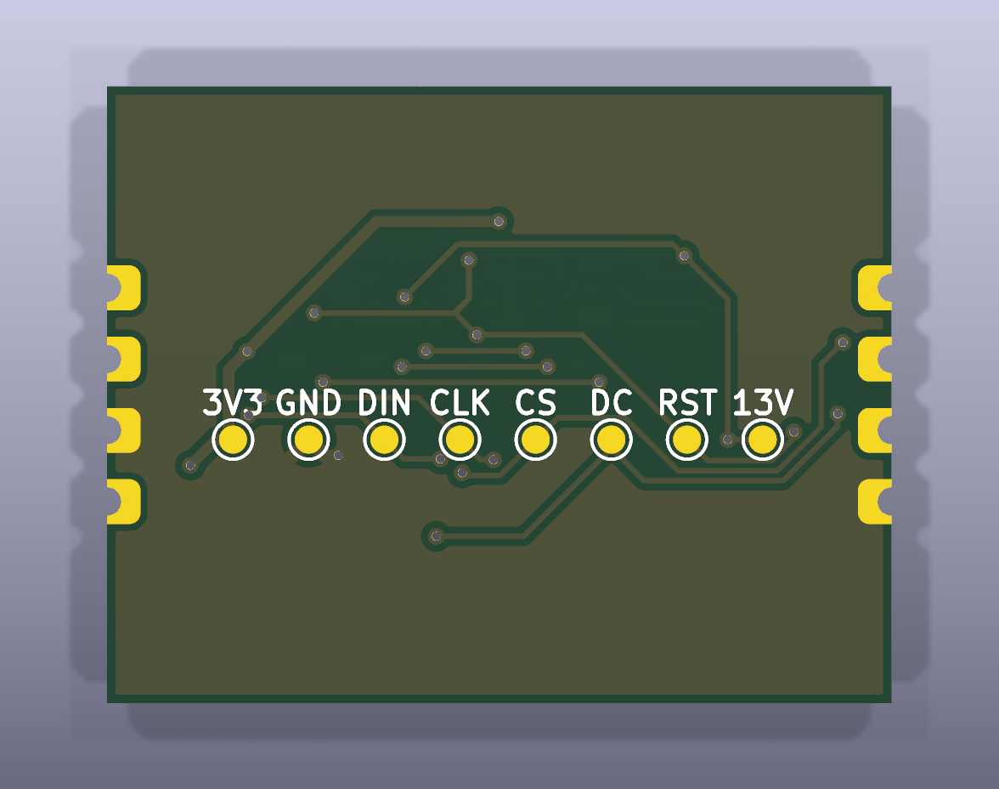
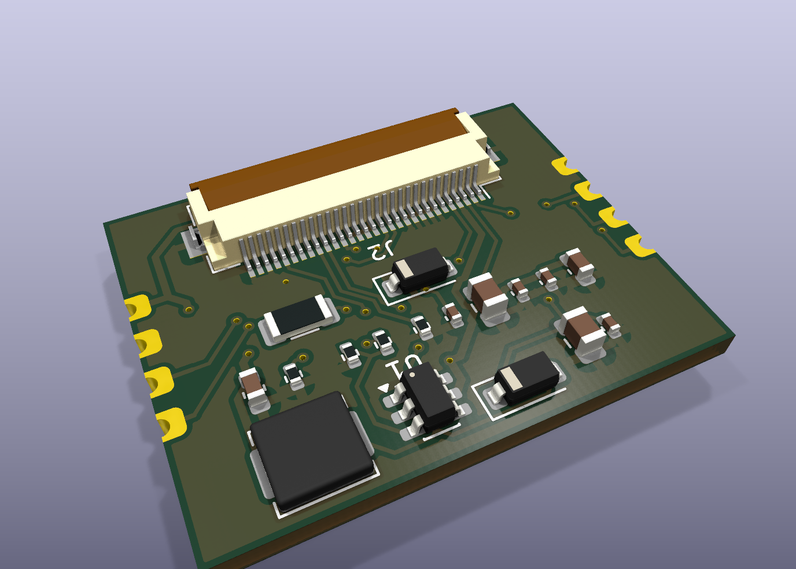
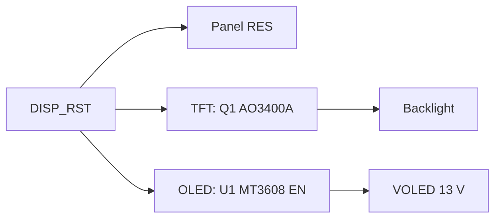

# chili-display-module

KiCad 10 projects for the **chilichip console display modules**. Each module is a small board with the panel's FPC connector and power parts, soldered to the main board by castellated pads on its left and right edges. The panel itself is glued or screwed to the console frame, and its flex tail plugs into the module. Both modules share one outline and pinout, so the screen is swappable ([vgc-zero-hardware #41](https://github.com/chili-chip/vgc-zero-hardware/issues/41)).

The main board gets a hole under the module. The module rests on two narrow ledges, is soldered by its edge pads, and its bottom parts sit inside the hole. This saves the height of a pin header.

Status: **v0.1.0, schematics and PCBs done, autorouted.** Both modules are 28 × 22 mm. ERC and DRC are clean on both boards (DRC with schematic parity). Not ordered or tested.

| Folder | Panel | Controller | Extra parts on the module |
|---|---|---|---|
| [`tft/`](tft/) | [EastRising ER-TFT1.44-3](https://www.buydisplay.com/square-1-44-inch-128x128-tft-lcd-display-4-wire-spi-st7735s), 1.44" TFT, 14-pin 0.5 mm FPC | ST7735S | Backlight switch |
| [`oled/`](oled/) | [EastRising ER-OLED015-1C](https://www.buydisplay.com/serial-spi-1-5-inch-color-oled-display-128x128-graphic-module-ssd1351), 1.5" OLED, 30-pin 0.5 mm FPC | SSD1351 | 13 V boost for the panel |

| TFT, top | TFT, bottom | OLED, top | OLED, bottom |
|:---:|:---:|:---:|:---:|
|  |  |  |  |

| TFT, parts side | OLED, parts side |
|:---:|:---:|
|  |  |

## What both modules share

| | |
|---|---|
| Outline | 28 × 22 mm, 1.6 mm FR-4, two layers |
| Edge pads | 8 castellated half-holes, 2.54 mm pitch, 1 mm drill: 4 on the left edge (J1), 4 on the right edge (J3) |
| Panel | Not on the module. It is mounted on the frame; its FPC tail wraps round the module's bottom edge into J2 |
| Parts side | Bottom. All parts stay inside x = 3…25 mm, so they fit in the main board hole. One-sided JLCPCB assembly |
| FPC connector | Hirose FH12 (0.5 mm, 0.3 mm FPC), bottom side, opening at the bottom edge |
| GND | Poured on both layers |
| Test pads | 8 bare 1 mm pads on the top side, labelled on the silkscreen (see below). No assembly needed |

Coordinates are top view, origin at the module's top-left corner.

### Edge pads

| Pad | Edge, y (mm) | Net | RP2350 GPIO |
|---|---|---|---|
| J1.1 | Left, 14.81 | 3V3 | |
| J1.2 | Left, 12.27 | GND | |
| J1.3 | Left, 9.73 | `DISP_DIN` | GP27 |
| J1.4 | Left, 7.19 | `DISP_CLK` | GP26 |
| J3.1 | Right, 7.19 | `DISP_CS` | GP28 |
| J3.2 | Right, 9.73 | `DISP_DC` | GP22 |
| J3.3 | Right, 12.27 | `DISP_RST` | GP21 |
| J3.4 | Right, 14.81 | GND | |

The signals and GPIOs are the same as the old Waveshare module, so the firmware pin map doesn't change.

### Test pads

Each module has a row of 8 test pads on its top side, for probing during bring-up before the panel goes on. They are bare copper, so they add no parts and no cost.

| Pad | TFT | OLED |
|---|---|---|
| TP1 | 3V3 | 3V3 |
| TP2 | GND | GND |
| TP3 | `DISP_DIN` | `DISP_DIN` |
| TP4 | `DISP_CLK` | `DISP_CLK` |
| TP5 | `DISP_CS` | `DISP_CS` |
| TP6 | `DISP_DC` | `DISP_DC` |
| TP7 | `DISP_RST` | `DISP_RST` |
| TP8 | BL: backlight cathode (`LED_K`) | 13V: panel supply (`VOLED`) |

### Main board footprint

[`chili-display-module.pretty/ChiliDisplayModule_Host.kicad_mod`](chili-display-module.pretty/ChiliDisplayModule_Host.kicad_mod) is the footprint for the main board. It has the 8 pads (numbered 1–8 in the order of the table above) and the hole on `Edge.Cuts`.

```
      0   2.5                      25.5  28   (mm)
  -1  .    +------------------------+    .
   0  +----|------------------------|----+   module outline
      |    |                        |    |
      |pad |       hole in the      | pad|   pads sit on the ledges,
      |pad |       main board       | pad|   2.5 mm wide on each side
      |pad |   (module parts here)  | pad|
      |pad |                        | pad|
  22  +----|------------------------|----+
  23       +------------------------+         hole runs 1 mm past the module
                                              at the top and bottom (FPC fold)
```

| | |
|---|---|
| Hole | 23 × 24 mm, x = 2.5…25.5, y = −1…23 |
| Host pads | 2.6 × 1.6 mm, centred 0.3 mm outside the module edge, so the solder fillet forms on the edge |
| Height above the main board | 1.6 mm (the module board). The panel sits on the frame above |
| Depth into the hole | Tallest bottom part: FH12 connector, 2.0 mm |

### Power follows `DISP_RST`

The console has no free GPIO, so each carrier uses the reset line as its on/off switch:

| `DISP_RST` | TFT carrier | OLED carrier |
|---|---|---|
| High (running) | Backlight on | 13 V boost on |
| Low (reset, sleep) | Backlight off | Boost off |

A 100 kΩ pull-down keeps everything off while the RP2350 boots. Each module needs only the five signals plus power, as before. Sleep mode must hold `DISP_RST` low ([32blit-sdk #97](https://github.com/chili-chip/32blit-sdk/issues/97)). The firmware picks the driver at boot ([32blit-sdk #108](https://github.com/chili-chip/32blit-sdk/issues/108)).



## TFT module

| Ref | Part | Value | LCSC | Why |
|---|---|---|---|---|
| J1, J3 | Castellated edge pads | | part of the board | To the main board |
| J2 | Hirose FH12-14S-0.5SH | | to pick | Panel FPC |
| C1, C2 | Decoupling | 100 nF, 4.7 µF | C1525, C19666 | VCC and IOVCC |
| R1 | Backlight resistor | 22 Ω | to pick | (3.3 − 3.0 V) / 22 Ω ≈ 14 mA. Max 18 mA at Vf 2.9 V, under the 20 mA limit |
| Q1 | AO3400A N-MOSFET | | C20917 | Switches the backlight cathode |
| R2 | Gate pull-down | 100 kΩ | C25741 | Backlight off while RST floats |

Panel pins (datasheet 4.1): 1 NC, 2 GND, 3 K, 4 A, 5 GND, 6 RST, 7 DC, 8 SDA, 9 SCL, 10 VCC, 11 IOVCC, 12 CS, 13 GND, 14 NC. VCC and IOVCC both take 3.3 V (max 3.3 V).

## OLED module

The panel circuit follows the reference circuit in the ER-OLED015-1C datasheet (1.6 Block Diagram). Interface is 4-wire SPI (BS0 = BS1 = 0). D0 is SCLK, D1 is SDIN, D3–D7, E/RD# and R/W# go to GND, D2 is left open.

| Ref | Part | Value | LCSC | Why |
|---|---|---|---|---|
| J2 | Hirose FH12-30S-0.5SH | | to pick | Panel FPC |
| C1, C2 | VCI | 100 nF, 4.7 µF | C1525, C19666 | VCI = 3.3 V (max 3.5 V) |
| C3 | VDDIO | 1 µF | C52923 | VDDIO = 3.3 V |
| C4 | VDD | 1 µF | C52923 | Internal 2.5 V regulator |
| C5, C6 | VCC (13 V) | 100 nF, 10 µF 25 V | to pick | |
| C7 | VCOMH | 4.7 µF 25 V | to pick | Ceramic instead of tantalum |
| R1 | IREF | 560 kΩ | to pick | Segment current < 12.5 µA |
| R2, D1 | External VSL | 51 Ω 1206, 1N4148W | to pick, C81598 | The firmware sets external VSL (0xB4 0xA0) |
| U1 | MT3608 boost | | C84817 | 3.3 V to 13 V, EN from `DISP_RST` |
| L1 | Inductor | 22 µH, 4 × 4 mm | to pick | |
| D2 | B5819W Schottky | | C8598 | |
| R3, R4 | Feedback | 130 kΩ, 6.2 kΩ | to pick | 0.6 V × (1 + 130/6.2) = 13.2 V (panel: 12.5–13.5 V) |
| R5 | EN pull-down | 100 kΩ | C25741 | Boost off while RST floats |
| C8 | Boost input | 10 µF | C19702 | |

Panel current: up to 42 mA at 13 V with the whole screen white (datasheet: 33.4 mA typ, 41.8 mA max). That is about 0.25 A from 3.3 V through the boost.

When the boost is off, VOLED sits at about 3 V through L1 and D2 (normal for a non-synchronous boost). The panel is in reset then, so it draws nothing.

## Still to do

- [ ] Review the autorouted boost loop on the OLED module (U1, L1, D2, C6) before ordering.
- [ ] Place the module on the main board where both panels' tails reach J2 (OLED tail: 14.35 mm past the panel edge, 15.5 mm wide).
- [ ] Check with a real panel which way the FPC wraps and which side its contacts face. If pin 1 ends up on the wrong side, mirror the pin order.
- [ ] Put the host footprint and hole on the main board ([vgc-zero-hardware](https://github.com/chili-chip/vgc-zero-hardware)) and line the shell window up with the panel.
- [ ] Pick the LCSC parts marked "to pick".
- [ ] JLCPCB export, CI and release, like the other module repos.

## Build

```sh
kicad-cli sch erc tft/chili-display-tft.kicad_sch
kicad-cli sch erc oled/chili-display-oled.kicad_sch
kicad-cli pcb drc --schematic-parity tft/chili-display-tft.kicad_pcb
kicad-cli pcb drc --schematic-parity oled/chili-display-oled.kicad_pcb
```

KiCad needs the standard symbol and footprint libraries. The castellated pads come from `chili-display-module.pretty`, which each project loads through its `fp-lib-table`.

When ordering at JLCPCB, set **Castellated Holes: Yes**. ENIG is recommended for the fine-pitch FPC connector.

## Licence

MIT, see [LICENSE](LICENSE).
