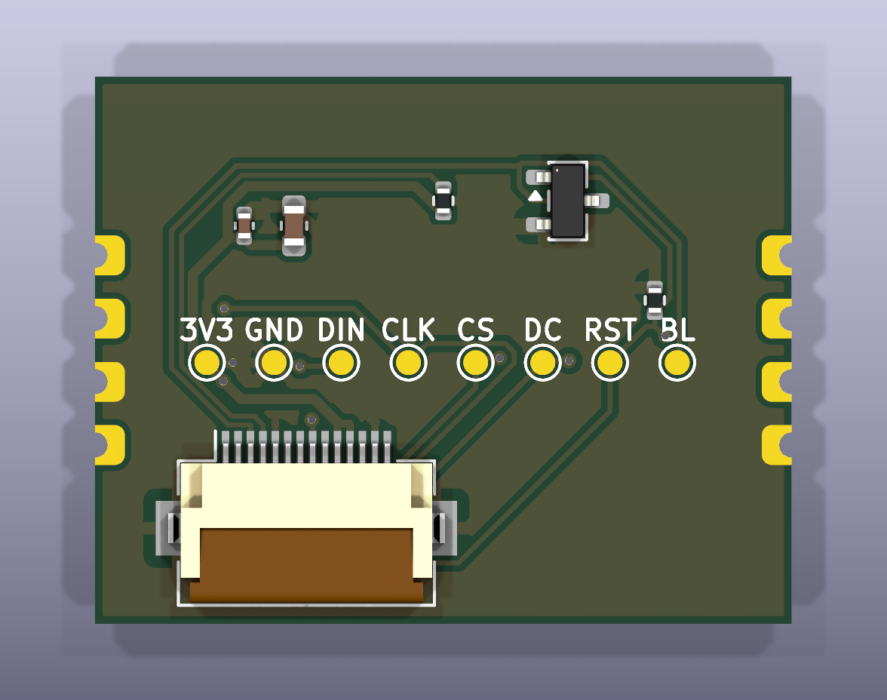
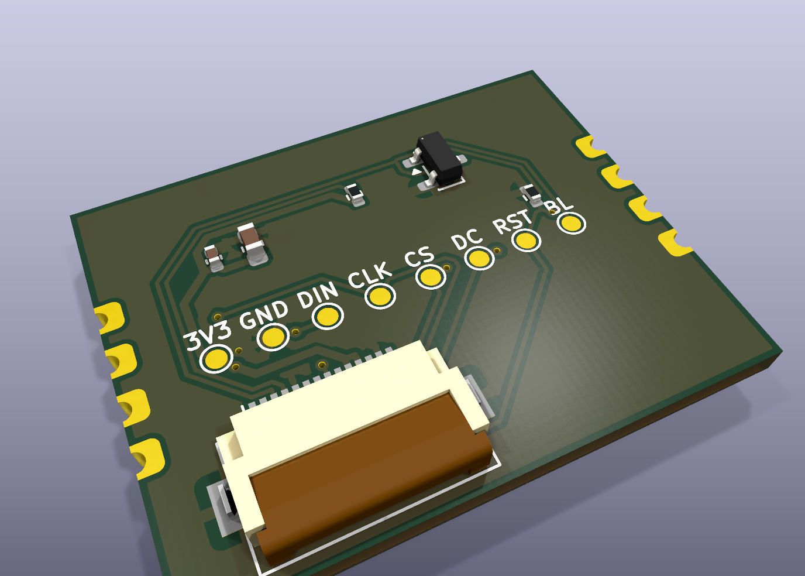
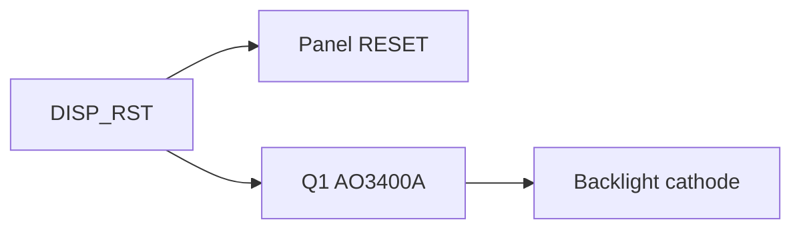

# chili-display-module

KiCad 10 project for the **chilichip console display module**. The module is a small board with the panel's FPC connector and backlight switch, soldered to the main board by castellated pads on its left and right edges. The panel itself is glued or screwed to the console frame, and its flex tail plugs into the module.

The console has one screen: the 2.0" IPS TFT, 320 × 240, mounted sideways. The 1.5" OLED and 1.44" TFT modules were dropped on 2026-11-27 (they are in the git history up to [#2](https://github.com/chili-chip/chili-display-module-hardware/pull/2)).

All parts are on the module's top side, so its bottom is flat. The module lies flat on the main board and is hand soldered by its edge pads, like a Raspberry Pi Pico.

Status: **schematic and PCB done, autorouted.** 28 × 22 mm. ERC and DRC are clean (DRC with schematic parity). Not ordered or tested.

| Folder | Panel | Controller | Extra parts on the module |
|---|---|---|---|
| [`tft/`](tft/) | [EastRising ER-TFT020-3](https://www.buydisplay.com/2-inch-240x320-ips-tft-lcd-display-with-connector-fpc), 2.0" IPS 320 × 240, 14-pin 0.5 mm FPC | ST7789 | Backlight switch |

| Top | Bottom |
|:---:|:---:|
|  |  |



## Board

| | |
|---|---|
| Outline | 28 × 22 mm, 1.6 mm FR-4, two layers |
| Edge pads | 8 castellated half-holes, 2.54 mm pitch, 1 mm drill: 4 on the left edge (J1), 4 on the right edge (J3) |
| Panel | Not on the module. It is mounted on the frame; its FPC tail folds back under the panel and plugs into J2 |
| Parts side | Top. The bottom is flat and lies on the main board. One-sided JLCPCB assembly |
| FPC connector | J2, Hirose FH12-14S (0.5 mm, 0.3 mm FPC), top side, opening at the bottom edge, centred at x = 8.5 mm (off centre, see below) |
| GND | Poured on both layers |
| Test pads | 8 bare 1 mm pads on the top side, labelled on the silkscreen (see below). No assembly needed |

Coordinates are top view, origin at the module's top-left corner.

### Edge pads

| Pad | Edge, y (mm) | Net | RP2350 GPIO |
|---|---|---|---|
| J1.1 | Left, 14.81 | 3V3 | |
| J1.2 | Left, 12.27 | GND | |
| J1.3 | Left, 9.73 | `DISP_DIN` | GP27 |
| J1.4 | Left, 7.19 | `DISP_CLK` | GP26 |
| J3.1 | Right, 7.19 | `DISP_CS` | GP28 |
| J3.2 | Right, 9.73 | `DISP_DC` | GP22 |
| J3.3 | Right, 12.27 | `DISP_RST` | GP21 |
| J3.4 | Right, 14.81 | GND | |

The signals and GPIOs are the same as the old Waveshare module, so the firmware pin map doesn't change.

### Test pads

8 test pads on the top side, for probing during bring-up before the panel goes on. They are bare copper, so they add no parts and no cost.

| Pad | Net |
|---|---|
| TP1 | 3V3 |
| TP2 | GND |
| TP3 | `DISP_DIN` |
| TP4 | `DISP_CLK` |
| TP5 | `DISP_CS` |
| TP6 | `DISP_DC` |
| TP7 | `DISP_RST` |
| TP8 | BL: backlight cathode (`LED_K`) |

### Main board footprint

[`chili-display-module.pretty/ChiliDisplayModule_Host.kicad_mod`](chili-display-module.pretty/ChiliDisplayModule_Host.kicad_mod) is the footprint for the main board. It has the 8 pads (numbered 1–8 in the order of the table above) and the module outline on the silkscreen.

```
      0                                28   (mm)
   0  +---------------------------------+   module outline
      |                                 |
     pad                               pad
     pad   keep parts and bare copper  pad   pads stick out 1.6 mm
     pad   out from under the module   pad   past each side edge
     pad                               pad
      |                                 |
  22  +---------------------------------+
```

| | |
|---|---|
| Host pads | 2.6 × 1.6 mm, centred 0.3 mm outside the module edge, so the solder fillet forms on the edge |
| Under the module | No parts and no bare copper. Tracks and tented vias are fine |
| Height above the main board | 3.6 mm: 1.6 mm board plus the FH12 connector (2.0 mm), the tallest part. The panel sits on the frame above |

### Backlight follows `DISP_RST`

The console has no free GPIO, so the reset line is also the backlight switch:

| `DISP_RST` | Backlight |
|---|---|
| High (running) | On |
| Low (reset, sleep) | Off |

A 100 kΩ pull-down keeps it off while the RP2350 boots. Sleep mode must hold `DISP_RST` low ([32blit-sdk #97](https://github.com/chili-chip/32blit-sdk/issues/97)).



## Parts

| Ref | Part | Value | LCSC | Why |
|---|---|---|---|---|
| J1, J3 | Castellated edge pads | | part of the board | To the main board |
| J2 | Hirose FH12-14S-0.5SH | | to pick | Panel FPC |
| C1, C2 | Decoupling | 100 nF, 4.7 µF | C1525, C19666 | VDD and IOVDD |
| R1 | Backlight resistor | 6.8 Ω | to pick | 3 LEDs in parallel: 45 mA typical, 60 mA max, Vf 3.0 V. (3.3 − 3.0 V) / 6.8 Ω ≈ 44 mA. At Vf 2.9 V it is 59 mA, still under the limit. About 13 mW, fine for 0402 |
| Q1 | AO3400A N-MOSFET | | C20917 | Switches the backlight cathode |
| R2 | Gate pull-down | 100 kΩ | C25741 | Backlight off while RST floats |

Panel pins (datasheet 4.1): 1 NC, 2 GND, 3 LED−, 4 LED+, 5 GND, 6 /RESET, 7 RS (DC), 8 SDA, 9 SCK, 10 VDD, 11 IOVDD, 12 CS, 13 GND, 14 NC. VDD (2.5–3.3 V) and IOVDD (1.8–3.3 V) both run at 3.3 V.

## Panel and mounting

| | |
|---|---|
| Outline | 47.8 × 34.6 × 2.05 mm |
| Active area | 40.8 × 30.6 mm |
| Mounting | Sideways (320 wide, 240 tall), glued or screwed to the frame |
| Tail | Leaves one short edge, off centre (centre line 13.55 mm from one long edge), about 13.5 mm long, 7.5 mm wide contact end. Turn the panel so the tail exits on the left, away from the antenna, and fold it back under the panel into J2 |
| TE pin | None |
| Brightness | 300 cd/m², not sunlight readable |

J2 is off centre (x = 8.5 mm, close to the J1 side) so the folded tail reaches it while the module's pads stay clear of the RP2350 board's USB-C slots on the main board.

Firmware: the `dbi_st7789_scaled` driver ([32blit-sdk #114](https://github.com/chili-chip/32blit-sdk/pull/114)) shows today's 128 × 128 games scaled to 240 × 240 in the middle of the panel. Full 320 × 240 for new games is [32blit-sdk #115](https://github.com/chili-chip/32blit-sdk/issues/115).

## Still to do

- [ ] Check with a real panel which way the FPC tail bends into J2 and which side its contacts face. If pin 1 ends up on the wrong side, mirror the pin order.
- [ ] Put the host footprint on the main board ([vgc-zero-hardware](https://github.com/chili-chip/vgc-zero-hardware)) and line the shell window up with the panel.
- [ ] Pick the LCSC parts marked "to pick".
- [ ] JLCPCB export, CI and release, like the other module repos.

## Build

```sh
kicad-cli sch erc tft/chili-display-tft.kicad_sch
kicad-cli pcb drc --schematic-parity tft/chili-display-tft.kicad_pcb
```

KiCad needs the standard symbol and footprint libraries. The castellated pads come from `chili-display-module.pretty`, which the project loads through its `fp-lib-table`.

When ordering at JLCPCB, set **Castellated Holes: Yes**. ENIG is recommended for the fine-pitch FPC connector.

## Licence

MIT, see [LICENSE](LICENSE).
