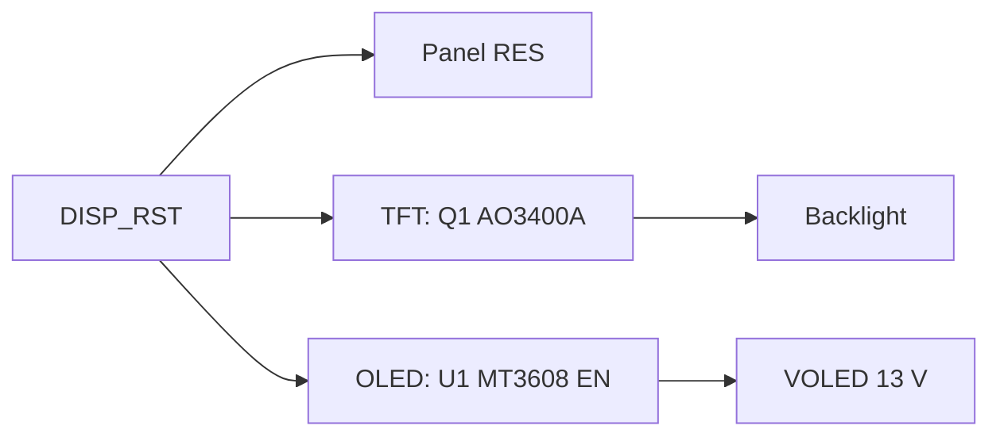
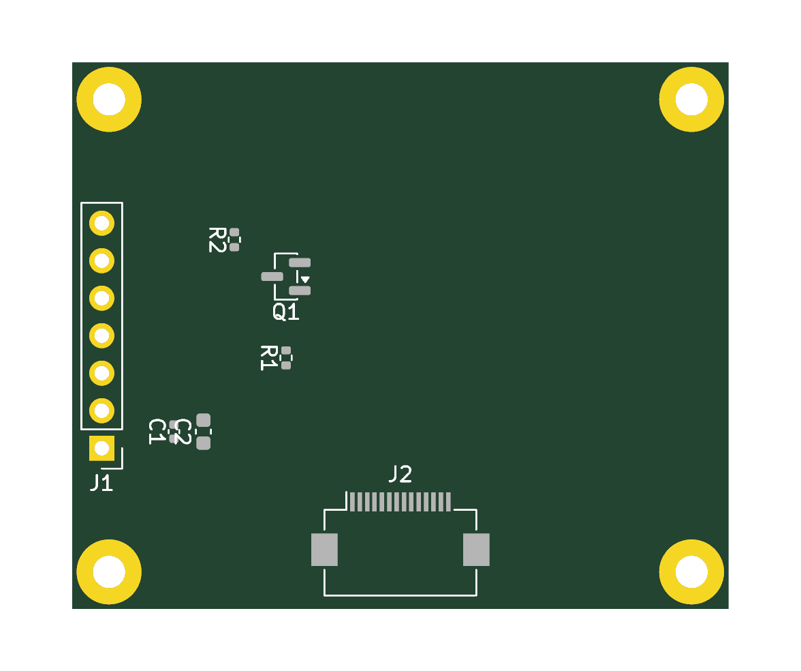
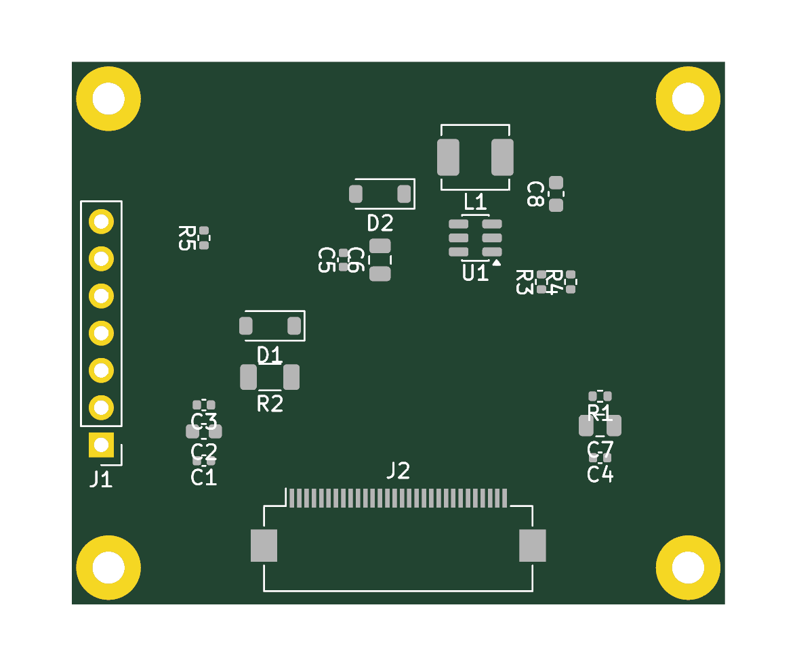

# chili-display-module

KiCad 10 projects for the **chilichip console display carriers**. Each carrier holds a bare display panel and copies the Waveshare 1.5" OLED module's footprint, so every screen plugs into the same spot on the main board ([vgc-zero-hardware #41](https://github.com/chili-chip/vgc-zero-hardware/issues/41)).

Status: **v0.1.0, schematics done, parts placed, not routed yet.** ERC is clean on both boards. Not ordered or tested.

| Folder | Panel | Controller | Extra parts on the carrier |
|---|---|---|---|
| [`tft/`](tft/) | [EastRising ER-TFT1.44-3](https://www.buydisplay.com/square-1-44-inch-128x128-tft-lcd-display-4-wire-spi-st7735s), 1.44" TFT, 14-pin 0.5 mm FPC | ST7735S | Backlight switch |
| [`oled/`](oled/) | [EastRising ER-OLED015-1C](https://www.buydisplay.com/serial-spi-1-5-inch-color-oled-display-128x128-graphic-module-ssd1351), 1.5" OLED, 30-pin 0.5 mm FPC | SSD1351 | 13 V boost for the panel |

## What both carriers share

| | |
|---|---|
| Outline | 44.5 × 37 mm, same as the Waveshare module |
| Holes | Four M2 holes at (2.5, 2.5), (2.5, 34.5), (42, 2.5), (42, 34.5), tied to GND |
| Header J1 | 7 pins, 2.54 mm, at x = 42.49 mm, pin 1 at y = 26.12 mm, pin 7 at y = 10.88 mm |
| Panel side | Top. The panel is centred between the holes |
| Parts side | Bottom, facing the main board. One-sided JLCPCB assembly |
| FPC connector | Hirose FH12 (0.5 mm, 0.3 mm FPC), bottom side, opening at the bottom edge. The panel's tail wraps round the edge |

Coordinates are top view, origin at the top-left corner, the same frame as `SSD1351_OLED_128x128_WAVESHARE` in vgc-zero-hardware.

### Header pinout

The same as the Waveshare module, so no GPIO changes.

| Pin | Net | RP2350 GPIO |
|---|---|---|
| 1 | 3V3 | |
| 2 | GND | |
| 3 | `DISP_DIN` | GP27 |
| 4 | `DISP_CLK` | GP26 |
| 5 | `DISP_CS` | GP28 |
| 6 | `DISP_DC` | GP22 |
| 7 | `DISP_RST` | GP21 |

### Power follows `DISP_RST`

The console has no free GPIO, so each carrier uses the reset line as its on/off switch:

| `DISP_RST` | TFT carrier | OLED carrier |
|---|---|---|
| High (running) | Backlight on | 13 V boost on |
| Low (reset, sleep) | Backlight off | Boost off |

A 100 kΩ pull-down keeps everything off while the RP2350 boots. Sleep mode must hold `DISP_RST` low ([32blit-sdk #97](https://github.com/chili-chip/32blit-sdk/issues/97)). The firmware picks the driver at boot ([32blit-sdk #108](https://github.com/chili-chip/32blit-sdk/issues/108)).



## TFT carrier



| Ref | Part | Value | LCSC | Why |
|---|---|---|---|---|
| J1 | Pin header 1x07 | | | To the main board |
| J2 | Hirose FH12-14S-0.5SH | | to pick | Panel FPC |
| C1, C2 | Decoupling | 100 nF, 4.7 µF | C1525, C19666 | VCC and IOVCC |
| R1 | Backlight resistor | 22 Ω | to pick | (3.3 − 3.0 V) / 22 Ω ≈ 14 mA. Max 18 mA at Vf 2.9 V, under the 20 mA limit |
| Q1 | AO3400A N-MOSFET | | C20917 | Switches the backlight cathode |
| R2 | Gate pull-down | 100 kΩ | C25741 | Backlight off while RST floats |

Panel pins (datasheet 4.1): 1 NC, 2 GND, 3 K, 4 A, 5 GND, 6 RST, 7 DC, 8 SDA, 9 SCL, 10 VCC, 11 IOVCC, 12 CS, 13 GND, 14 NC. VCC and IOVCC both take 3.3 V (max 3.3 V).

## OLED carrier



The panel circuit follows the reference circuit in the ER-OLED015-1C datasheet (1.6 Block Diagram). Interface is 4-wire SPI (BS0 = BS1 = 0). D0 is SCLK, D1 is SDIN, D3–D7, E/RD# and R/W# go to GND, D2 is left open.

| Ref | Part | Value | LCSC | Why |
|---|---|---|---|---|
| J2 | Hirose FH12-30S-0.5SH | | to pick | Panel FPC |
| C1, C2 | VCI | 100 nF, 4.7 µF | C1525, C19666 | VCI = 3.3 V (max 3.5 V) |
| C3 | VDDIO | 1 µF | C52923 | VDDIO = 3.3 V |
| C4 | VDD | 1 µF | C52923 | Internal 2.5 V regulator |
| C5, C6 | VCC (13 V) | 100 nF, 10 µF 25 V | to pick | |
| C7 | VCOMH | 4.7 µF 25 V | to pick | Ceramic instead of tantalum |
| R1 | IREF | 560 kΩ | to pick | Segment current < 12.5 µA |
| R2, D1 | External VSL | 51 Ω 1206, 1N4148W | to pick, C81598 | The firmware sets external VSL (0xB4 0xA0) |
| U1 | MT3608 boost | | C84817 | 3.3 V to 13 V, EN from `DISP_RST` |
| L1 | Inductor | 22 µH, 4 × 4 mm | to pick | |
| D2 | B5819W Schottky | | C8598 | |
| R3, R4 | Feedback | 130 kΩ, 6.2 kΩ | to pick | 0.6 V × (1 + 130/6.2) = 13.2 V (panel: 12.5–13.5 V) |
| R5 | EN pull-down | 100 kΩ | C25741 | Boost off while RST floats |
| C8 | Boost input | 10 µF | C19702 | |

Panel current: up to 42 mA at 13 V with the whole screen white (datasheet: 33.4 mA typ, 41.8 mA max). That is about 0.25 A from 3.3 V through the boost.

When the boost is off, VOLED sits at about 3 V through L1 and D2 (normal for a non-synchronous boost). The panel is in reset then, so it draws nothing.

## Still to do

- [ ] Route both boards and pour GND, then DRC clean.
- [ ] Check with a real panel which way the FPC wraps and which side its contacts face. If pin 1 ends up on the wrong side, mirror the pin order.
- [ ] Check the panels' visible area lines up with the Waveshare OLED (the shell window).
- [ ] Check the height of the bottom parts against the space under the module.
- [ ] Pick the LCSC parts marked "to pick".
- [ ] JLCPCB export, CI and release, like the other module repos.

## Build

```sh
kicad-cli sch erc tft/chili-display-tft.kicad_sch
kicad-cli sch erc oled/chili-display-oled.kicad_sch
kicad-cli pcb drc tft/chili-display-tft.kicad_pcb
```

## Licence

MIT, see [LICENSE](LICENSE).
